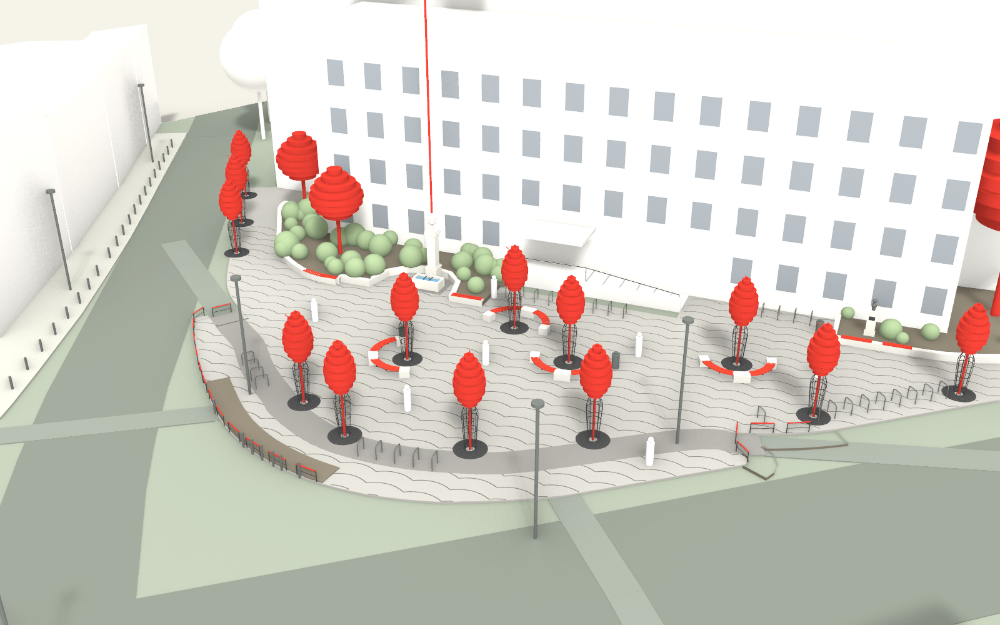

# Theaterbrunnen, Weimar: site model

A 3D site model of the Theaterbrunnen plaza at Sophienstiftsplatz / Heinrich-Heine-Straße in Weimar (plus code X8HF+RHP), next to the Deutsches Nationaltheater. It is drawn in the colour style of a physical presentation model: a sage-grey base, white building blocks, and red for the trees and timber seats of the plaza.

## Files

| File | Use it with |
|---|---|
| `Theaterbrunnen_Weimar_SiteModel.3dm` | Rhino 8 |
| `Theaterbrunnen_Weimar_SiteModel_Rhino7.3dm` | Rhino 7 |
| `Theaterbrunnen_Weimar_SiteModel_Rhino6.3dm` | Rhino 6 |
| `Theaterbrunnen_Weimar_SiteModel.fbx` | Blender, 3ds Max, Cinema 4D, Revit |
| `Theaterbrunnen_Weimar_SiteModel.obj` + `.mtl` | Any 3D viewer (keep the `.mtl` next to the `.obj`) |
| `Theaterbrunnen_Weimar_SiteModel.skp` | SketchUp. Some very small faces may be missing; use the FBX if so. |
| `renders/` | Plan, aerial, eye-level and detail views |
| `data/site_model_data.json` | The OpenStreetMap features used, in local metres |
| `scripts/` | Helper code used to build the model in Rhino (Python) |

The model files are stored with Git LFS. Install it (`git lfs install`) before cloning, or download them from the GitHub web page.

## Coordinates and units

- Units are metres. x points east, y points north.
- The origin is 50.97959 N, 11.32395 E.
- The plinth covers x −60…60 and y −55…50.

## Where the geometry comes from

Positions and outlines come from OpenStreetMap:

- buildings and building parts
- the plaza's sett paving area and the cycle path across it
- the 0.4 m walls of the fountain bed
- the Theaterbrunnen and the bust of Johann Nepomuk Hummel
- each young tree, bench point and bike-parking group (with its capacity)
- bollards, lamps, bins and the hoop-guard rails

The distances between the bench clusters were checked against a satellite image, and they agree within about 1 m.

Detail that OpenStreetMap does not record was modelled from street-level photos (Oct 2022). That covers the pillar fountain with its urn, shell spout and trough; the concrete-block and timber bench arcs; the tree cages and grates; the entrance stair and canopy; and the segmental-arc paving pattern.

### Approximate parts

- Building heights come from storey counts. The DNT south wing is 16 m, with four storeys of windows.
- The window pattern is approximate.
- Bench arc span and block sizes are read from the photos. Arc radius to the seat centre is about 1.95 m.
- Each bench arc faces the direction of its mapped bench point.

## Layers

| Layer | Contents |
|---|---|
| `00_Base` | Plinth |
| `01_Roads`, `01b_Cycleways`, `04d_Sidewalks` | Streets and sidewalks |
| `04_Plaza_Paving`, `04b_Paving_Joints`, `04c_Cycle_Path_Sett` | Plaza surface |
| `05_Buildings`, `05b_DNT_Wing`, `21_Entrance`, `22_Windows` | Buildings |
| `10_Focus_Trees`, `13_Tree_Grates_Cages` | Young plaza trees and the bed trees |
| `11_Bench_Timber`, `12_Bench_Concrete` | Benches and seat caps |
| `14_Water`, `15_Fountain_Stone`, `15b_Walls` | Theaterbrunnen and bed walls |
| `18_Shrubs`, `03b_Planting_Soil`, `03_Green` | Planting |
| `19_Street_Furniture`, `20_Hoop_Guards_Red` | Bike stands, bollards, lamps, bins, hoop guards |
| `06_Context_Trees`, `17_People`, `16_Red_Markers` | Context trees, scale figures, floating marker |

## Data licence

Map data © OpenStreetMap contributors, available under the Open Database License (ODbL): <https://www.openstreetmap.org/copyright>. `data/site_model_data.json` is a derived database and is shared under the ODbL as well.
